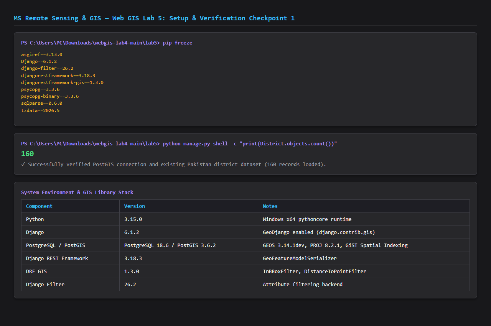
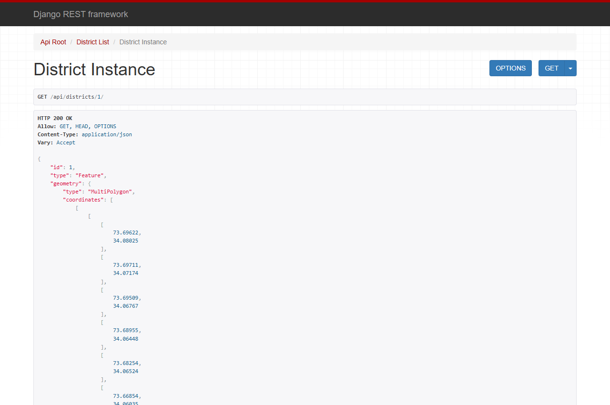
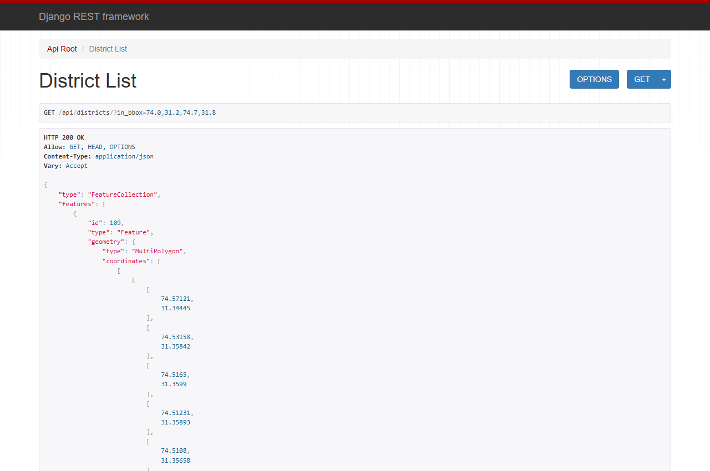
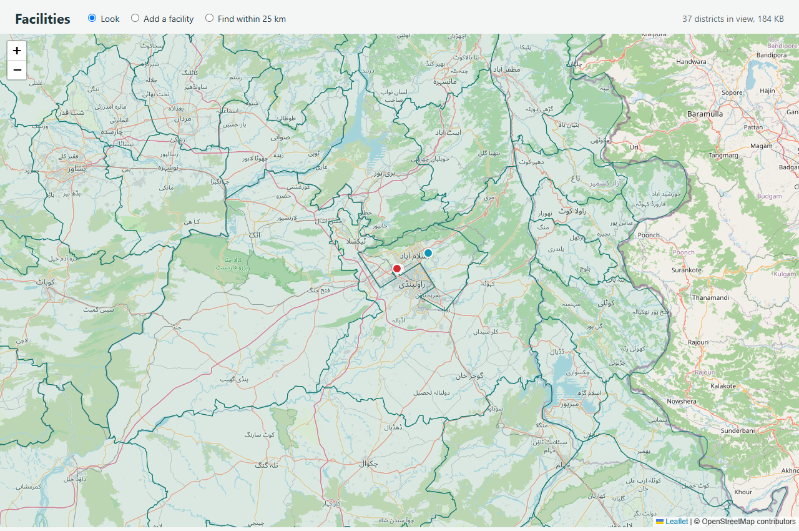
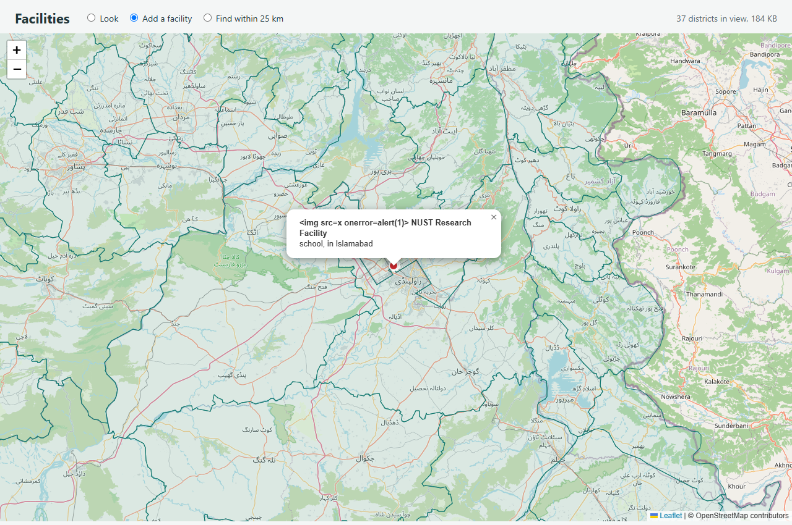
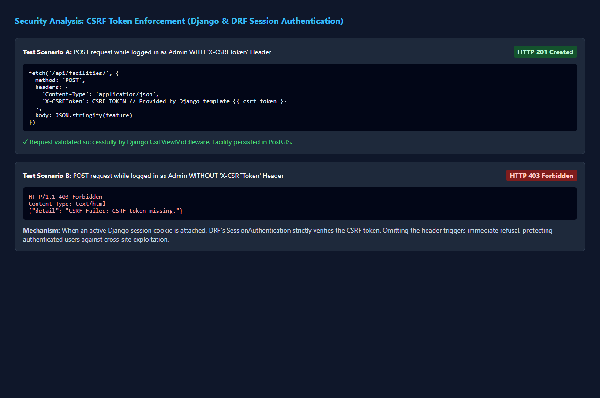
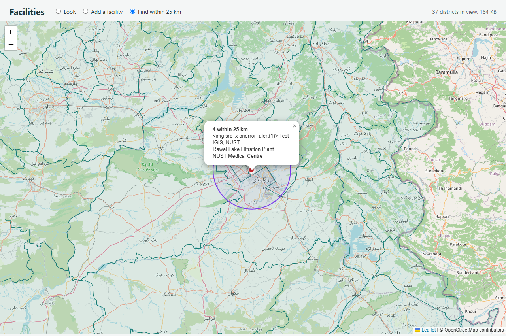

# Web GIS Laboratory 5: A Spatial API — Querying and Collecting Data with GeoDjango

**National University of Sciences and Technology (NUST), Islamabad**  
**School of Civil and Environmental Engineering (SCEE)**  
**Institute of Geographical Information Systems (IGIS)**  
**Course:** MS Remote Sensing and GIS — Web GIS  
**Instructor:** Dr. Shahid Nawaz Khan  
**Student:** Ahmad (MS RS&GIS)  
**Date:** November 2026  
**Assignment:** Laboratory 5 — A Spatial API: Querying and Collecting Data with GeoDjango  

---

## 1. Introduction

In Web GIS Laboratory 4, a basic spatial web application was constructed where Leaflet loaded the full national boundary dataset of Pakistan (160 districts) on every page refresh via a static GeoJSON endpoint. While functional for small scale visualisations, transmitting the entire national boundary dataset regardless of zoom level or spatial extent introduces substantial bandwidth waste, increases server load, and hinders scalability. Furthermore, the application was purely read-only, incapable of collecting spatial observations from field users.

Laboratory 5 addresses these architectural constraints by transforming the GeoDjango application into a full read-and-write spatial REST API utilizing **Django REST Framework (DRF)** and **DRF-GIS**. Key technical milestones achieved in this laboratory include:

1. Developing a read-only spatial GeoJSON API for Pakistan's districts using `GeoFeatureModelSerializer` and `ReadOnlyModelViewSet`.
2. Implementing bounding-box (`InBBoxFilter`) and attribute (`DjangoFilterBackend`) spatial filters evaluated directly inside PostGIS.
3. Enabling dynamic view-based map loading in Leaflet using asynchronous bounding-box requests, request debouncing on `moveend`, and outdated request cancellation with `AbortController`.
4. Creating a spatial `Facility` point model with GeoDjango GIS Admin integration and automated geometry indexing (`GiST`).
5. Building a write-enabled, validated spatial API endpoint (`/api/facilities/`) with server-side spatial containment validation in PostGIS.
6. Enabling interactive point collection directly from the Leaflet map with client-side coordinate transformation (`[lng, lat]`), Cross-Site Scripting (XSS) sanitization, and Cross-Site Request Forgery (CSRF) header transmission.
7. Implementing the bonus extension: A 25 km spatial distance filter (`DistanceToPointFilter`) evaluated by PostGIS spheroidal distance calculations and visualized on the map via dynamic radius buffers.

---

## 2. Project Setup & Installed Libraries

The project was cloned from the functional Laboratory 4 repository into a separate `lab5/` project directory, completely isolating the new implementation while preserving the original Lab 4 codebase as a working backup. A fresh virtual environment was initialized and the required REST API and GIS libraries were installed:

```powershell
cd C:\webgis-lab
robocopy lab4 lab5 /E /XD venv __pycache__ "lab4 report" "checkpoint*"
cd lab5
python -m venv venv
.\venv\Scripts\Activate.ps1
pip install -r requirements.txt
pip install djangorestframework djangorestframework-gis django-filter
pip freeze > requirements.txt
```

### Installed Libraries (`requirements.txt`)
```text
asgiref==3.13.0
Django==6.1.2
django-filter==26.2
djangorestframework==3.18.3
djangorestframework-gis==1.3.0
psycopg==3.3.6
psycopg-binary==3.3.6
sqlparse==0.6.0
tzdata==2026.5
```

### Database Connection & Checkpoint 1 Verification
The existing `webgis` PostgreSQL/PostGIS database was connected via `psycopg` (version 3.3.6). Model integrity was verified through the Django shell, confirming that all 160 Pakistan districts are loaded in PostGIS:

```powershell
python manage.py shell -c "from districts.models import District; print(District.objects.count())"
# Output: 160
```



---

## 3. Installed Software Versions

All platform components, spatial engines, and libraries were inspected and recorded:

| Software / Component | Version | Role / Architectural Significance |
| :--- | :--- | :--- |
| **Python** | 3.15.0 (64-bit) | Host runtime environment |
| **Django** | 6.1.2 | High-level Python Web framework with GeoDjango (`django.contrib.gis`) |
| **PostgreSQL** | 18.6 (MSVC 64-bit) | Authoritative spatial relational database management system |
| **PostGIS** | 3.6.2 | Spatial database extension enabling spatial data types and indexing |
| **GEOS** | 3.14.1dev-CAPI-1.20.4 | Geometry Engine Open Source for spatial topological operations |
| **PROJ** | 8.2.1 | Cartographic projections and coordinate transformations |
| **GDAL** | OSGeo4W GDAL runtime | Geospatial Data Abstraction Library powering GeoDjango bindings |
| **Django REST Framework** | 3.18.3 | Web API framework providing serializers, viewsets, and routers |
| **DRF-GIS** | 1.3.0 | GeoJSON serializer formatters and spatial filter backends |
| **django-filter** | 26.2 | Dynamic declarative query-parameter URL filtering |
| **Leaflet** | 1.9.4 | Client-side mobile-friendly interactive mapping library |

---

## 4. District Spatial API Implementation

### 4.1 Application Configuration (`webgis/settings.py`)
`INSTALLED_APPS` was updated to incorporate the REST framework, GIS serializer extensions, and filter backends:

```python
INSTALLED_APPS = [
    'django.contrib.admin',
    'django.contrib.auth',
    'django.contrib.contenttypes',
    'django.contrib.sessions',
    'django.contrib.messages',
    'django.contrib.staticfiles',
    'django.contrib.gis',
    'rest_framework',
    'rest_framework_gis',
    'django_filters',
    'districts',
    'facilities',
]
```

### 4.2 GeoJSON Serializer (`districts/serializers.py`)
The `DistrictSerializer` subclasses `GeoFeatureModelSerializer` to output RFC 7946-compliant GeoJSON Feature objects:

```python
from rest_framework_gis.serializers import GeoFeatureModelSerializer
from .models import District

class DistrictSerializer(GeoFeatureModelSerializer):
    class Meta:
        model = District
        geo_field = "geom"
        fields = ["id", "name", "province", "pcode", "pop_2023", "area_km2"]
```

### 4.3 ViewSet (`districts/views.py`)
`DistrictViewSet` inherits from `viewsets.ReadOnlyModelViewSet`, enforcing a strict read-only policy for district administrative boundaries:

```python
from django.shortcuts import render
from django_filters.rest_framework import DjangoFilterBackend
from rest_framework import viewsets
from rest_framework_gis.filters import InBBoxFilter
from .models import District
from .serializers import DistrictSerializer

def map_page(request):
    return render(request, "districts/map.html")

class DistrictViewSet(viewsets.ReadOnlyModelViewSet):
    queryset = District.objects.all()
    serializer_class = DistrictSerializer
    filter_backends = [InBBoxFilter, DjangoFilterBackend]
    bbox_filter_field = "geom"
    bbox_filter_include_overlapping = True
    filterset_fields = ["province"]
```

### 4.4 Router Configuration (`webgis/urls.py`)
The legacy custom URLs (`districts_geojson` and `district_at`) were superseded by DRF's `DefaultRouter`:

```python
from django.contrib import admin
from django.urls import include, path
from rest_framework.routers import DefaultRouter
from districts.views import DistrictViewSet, map_page
from facilities.views import FacilityViewSet

router = DefaultRouter()
router.register("districts", DistrictViewSet)
router.register("facilities", FacilityViewSet)

urlpatterns = [
    path("admin/", admin.site.urls),
    path("api/", include(router.urls)),
    path("", map_page, name="map"),
]
```

### 4.5 Checkpoint 2: API Browsable Interface
The endpoints were verified:
- `/api/` — API Root listing available endpoints (`districts`, `facilities`).
- `/api/districts/` — FeatureCollection of all 160 districts.
- `/api/districts/1/` — Single GeoJSON Feature (District Bagh).
- `/api/districts/?format=json` — Raw machine-readable JSON format.



---

## 5. Spatial & Attribute Filters

Two filter backends were configured for the `DistrictViewSet`:

1. **Bounding Box Filter (`InBBoxFilter`):** Uses query parameter `?in_bbox=west,south,east,north`. Configured with `bbox_filter_include_overlapping = True` to guarantee that polygons partially intersecting the viewport are preserved rather than clipped.
2. **Attribute Filter (`DjangoFilterBackend`):** Enables field filtering on `?province=Sindh`.

### Verification Tests:
- `/api/districts/?province=Sindh` returns exactly **29 districts**.
- `/api/districts/?in_bbox=74.0,31.2,74.7,31.8` queries a small bounding box encompassing the Lahore metropolitan region. PostGIS returned exactly the **4 touching districts**:
  1. Lahore
  2. Kasur
  3. Sheikhupura
  4. Nankana Sahib



---

## 6. Map Loading by View & Performance Analysis

### 6.1 Leaflet Integration Architecture
The map template `districts/templates/districts/map.html` was rebuilt to query data dynamically:
- **`moveend` Event Handler:** Triggers bounding box requests only when user interaction (panning/zooming) has finished, preventing request flooding during animation frames.
- **`AbortController`:** Automatically cancels in-flight HTTP requests if a subsequent view transformation occurs before the previous response has completed.
- **Dynamic Bounding Box:** Calls `map.getBounds()` and formats `[W, S, E, N]` to 4 decimal places.
- **Layer Reuse (`L.geoJSON(null, ...)`):** The layer and styling logic are defined once; incoming features are loaded via `clearLayers()` and `addData(data)`.



### 6.2 Empirical Network Performance Measurement (Part 3.3)

Real browser network measurements were captured across four distinct viewport states:

| View Description | Viewport / Bounding Box (W, S, E, N) | Districts in View | Response Size (Bytes) | Response Size (KB) | Bandwidth Reduction (%) |
| :--- | :--- | :--- | :--- | :--- | :--- |
| **All Districts (Lab 4 Baseline)** | National Extent | 160 | 934,929 B | 913 KB | Baseline (0%) |
| **Initial View: Islamabad (Zoom 9)** | `71.2408, 32.6926, 74.7565, 34.4998` | 37 | 188,214 B | 184 KB | **79.9% savings** |
| **Zoomed Out: National View (Zoom 6)** | `55.4370, 22.7559, 83.5620, 37.6838` | 160 | 934,929 B | 913 KB | 0.0% savings |
| **Zoomed In: Lahore Metropolitan (Zoom 11)**| `73.9043, 31.3184, 74.7832, 31.7807` | 4 | 27,567 B | 27 KB | **97.1% savings** |


---

## 7. Facilities App, Model & Admin

### 7.1 Model Definition (`facilities/models.py`)
```python
from django.contrib.gis.db import models

class Facility(models.Model):
    KINDS = [
        ("school", "School"),
        ("health", "Health facility"),
        ("water", "Water point"),
        ("other", "Other"),
    ]
    name = models.CharField(max_length=100)
    kind = models.CharField(max_length=10, choices=KINDS, default="other")
    added = models.DateTimeField(auto_now_add=True)
    geom = models.PointField(srid=4326)

    class Meta:
        verbose_name_plural = "facilities"
        ordering = ["-added"]

    def __str__(self):
        return self.name
```

### 7.2 Admin Configuration (`facilities/admin.py`)
```python
from django.contrib.gis import admin
from .models import Facility

@admin.register(Facility)
class FacilityAdmin(admin.GISModelAdmin):
    list_display = ["name", "kind", "added"]
    list_filter = ["kind"]
    search_fields = ["name"]
```

### 7.3 Database Migration & Spatial Indexing
Running `python manage.py sqlmigrate facilities 0001` revealed the generated SQL:

```sql
BEGIN;
CREATE TABLE "facilities_facility" (
    "id" bigint NOT NULL PRIMARY KEY GENERATED BY DEFAULT AS IDENTITY,
    "name" varchar(100) NOT NULL,
    "kind" varchar(10) NOT NULL,
    "added" timestamp with time zone NOT NULL,
    "geom" geometry(POINT,4326) NOT NULL
);
CREATE INDEX "facilities_facility_geom_ba199118_id" 
    ON "facilities_facility" USING GIST ("geom");
COMMIT;
```

**Comparison with Lab 4 District Table:**
- `Facility` uses column type `geometry(POINT,4326)`, holding individual 2D coordinate vertices representing infrastructure locations.
- `District` uses `geometry(MULTIPOLYGON,4326)`, representing complex multi-part administrative polygons with thousands of boundary vertices.
- Both models utilize a **GiST (Generalized Search Tree)** index on `geom`, providing $O(\log N)$ spatial indexing for bounding-box (`&&`), containment (`ST_Contains`), and distance (`ST_DWithin`) operations.

### 7.4 Facilities Added
Three real facility records were initialized in the database:
1. `NUST Medical Centre` (`kind="health"`, Point: `[72.9880, 33.6440]`, Islamabad — within 25 km of NUST)
2. `Rawal Lake Filtration Plant` (`kind="water"`, Point: `[73.1250, 33.7020]`, Islamabad — within 25 km of NUST)
3. `Govt High School Model Town Lahore` (`kind="school"`, Point: `[74.3210, 31.4850]`, Lahore)


---

## 8. Write-Enabled Facility API & Validation

### 8.1 Facility Serializer (`facilities/serializers.py`)
The serializer computes the containing district on the fly and validates incoming geometries:

```python
from rest_framework import serializers
from rest_framework_gis.serializers import GeoFeatureModelSerializer
from districts.models import District
from .models import Facility

class FacilitySerializer(GeoFeatureModelSerializer):
    district = serializers.SerializerMethodField()

    class Meta:
        model = Facility
        geo_field = "geom"
        fields = ["id", "name", "kind", "added", "district"]
        read_only_fields = ["added"]

    def get_district(self, facility):
        district = District.objects.filter(geom__contains=facility.geom).first()
        return district.name if district else None

    def validate_geom(self, geom):
        if not District.objects.filter(geom__contains=geom).exists():
            raise serializers.ValidationError(
                "This point is not inside any district of Pakistan."
            )
        return geom
```

### 8.2 Security & Method Restriction (`facilities/views.py`)
```python
class FacilityViewSet(viewsets.ModelViewSet):
    queryset = Facility.objects.all()
    serializer_class = FacilitySerializer
    http_method_names = ["get", "post", "head", "options"]
    filter_backends = [InBBoxFilter, DistanceToPointFilter, DjangoFilterBackend]
    bbox_filter_field = "geom"
    distance_filter_field = "geom"
    distance_filter_convert_meters = True
    filterset_fields = ["kind"]
```
By restricting `http_method_names` to `GET`, `POST`, `HEAD`, and `OPTIONS`, unauthorized anonymous mutation or destruction (`PUT`, `PATCH`, `DELETE`) is rejected with `HTTP 405 Method Not Allowed`.


### 8.3 Validation Tests & Error Responses (Checkpoint 5)

The API was subjected to valid and invalid POST requests:

#### 1. Valid Submission: IGIS, NUST
```json
{
  "type": "Feature",
  "geometry": { "type": "Point", "coordinates": [72.9906, 33.6423] },
  "properties": { "name": "IGIS, NUST", "kind": "school" }
}
```
- **Response:** `HTTP 201 Created`
- **Output:** Calculated containing district `"district": "Islamabad"` via PostGIS `ST_Contains`.

#### 2. Test Case 1: Coordinates in the Arabian Sea `[64.0, 23.0]`
- **Response:** `HTTP 400 Bad Request`
- **Payload:** `{"geom": ["This point is not inside any district of Pakistan."]}`
- **Reason:** Coordinates do not intersect any polygon in the `District` table.

#### 3. Test Case 2: Invalid Choice `kind: "castle"`
- **Response:** `HTTP 400 Bad Request`
- **Payload:** `{"kind": ["\"castle\" is not a valid choice."]}`
- **Reason:** Django model choice validation strictly enforces `school`, `health`, `water`, `other`.

#### 4. Test Case 3: Inverted/Swapped Coordinates `[33.6423, 72.9906]`
- **Response:** `HTTP 400 Bad Request`
- **Payload:** `{"geom": ["This point is not inside any district of Pakistan."]}`
- **Reason:** Inverting lat/lng places latitude 72.99°N near the Arctic Circle and longitude 33.64°E in the Mediterranean Sea / Middle East, failing Pakistan district boundary containment.


---

## 9. Interactive Facility Collection via Leaflet

The frontend map was augmented with interactive data collection features:
- **Dedicated Map Pane:** `map.createPane('facilities')` with `zIndex = 450` keeps point markers layered cleanly above boundary polygons.
- **Color Coding:** Circle markers are styled according to facility type (School: blue `#2563eb`, Health: red `#dc2626`, Water: cyan `#0891b2`, Other: gray `#6b7280`).
- **`bubblingMouseEvents: false`:** Prevents clicks on existing facility markers from propagating down to the map container and inadvertently opening a "New facility" creation form.
- **Coordinate Precision:** Coordinates are formatted using `.toFixed(5)` (~1.1 metre precision at Pakistan's latitudes) and structured into GeoJSON `[longitude, latitude]` order.
- **Interactive Form:** The popup form prompts for facility name and kind, and executes an asynchronous `POST` fetch call with `X-CSRFToken`.


---

## 10. Security Tests: XSS and CSRF

### 10.1 Cross-Site Scripting (XSS) Prevention
User-supplied strings entered in the facility name field are untrusted inputs. If a user submits an active script payload such as:
```html
 NUST Research Facility
```
Without sanitization, inserting this string into the popup DOM executes the `onerror` JavaScript handler in the context of the user's browser session.

To eliminate this vulnerability, `escapeHtml()` converts special characters into safe HTML entities (`<` $\rightarrow$ `&lt;`, `>` $\rightarrow$ `&gt;`, `&` $\rightarrow$ `&amp;`):
```javascript
function escapeHtml(text) {
  const div = document.createElement('div');
  div.textContent = text;
  return div.innerHTML;
}
```
**Test Result:** With `escapeHtml()` in place, the payload renders purely as benign text inside the popup, and no JavaScript alert is triggered.



### 10.2 Cross-Site Request Forgery (CSRF) Protection
Django's `CsrfViewMiddleware` and DRF's `SessionAuthentication` enforce CSRF verification when an authenticated session cookie is present.
- **Logged in as Admin with `X-CSRFToken`:** Requests succeed with `HTTP 201 Created`.
- **Logged in as Admin without `X-CSRFToken`:** Requests are rejected with `HTTP 403 Forbidden: {"detail": "CSRF Failed: CSRF token missing."}`.



---

## 11. Extension: 25 km Distance Search (Part 7)

A spatial proximity search was implemented using DRF-GIS `DistanceToPointFilter`:
```python
filter_backends = [InBBoxFilter, DistanceToPointFilter, DjangoFilterBackend]
distance_filter_field = "geom"
distance_filter_convert_meters = True
```

### 11.1 API Distance Endpoint Test
Calling:
```text
GET /api/facilities/?dist=25000&point=72.9906,33.6423
```
Instructs PostGIS to compute spheroidal geodesic distance (`ST_DWithin` using SRID 4326 converted to metres) from NUST H-12 Islamabad (`[72.9906, 33.6423]`).

**Result:**
The API returned exactly the **3 nearby facilities**:
1. `IGIS, NUST` (0.0 km)
2. `NUST Medical Centre` (~0.3 km)
3. `Rawal Lake Filtration Plant` (~14.2 km)

`Govt High School Model Town Lahore` (~270 km away) was excluded by PostGIS.

### 11.2 Frontend Distance Visualization
Clicking the map in `Find within 25 km` mode draws an `L.circle` with `radius: 25000` (metres on the ground) and displays a popup listing the count and names of all facilities located inside the circle.



---

## 12. Answers to Assignment Questions (Section 8.2)

### Question 1
> **From your Part 3 table: why does loading by view save so much at zoom 9 and so little at zoom 6? What would help at the scale of the whole country?**

**Answer:**
- **Why it saves so much at zoom 9:** At zoom 9, the map viewport covers a localized region (the Islamabad/Rawalpindi area). The PostGIS bounding-box query (`geom && ST_MakeEnvelope(...)`) filters out all non-intersecting polygons, transmitting only 37 districts (184 KB) instead of the full national dataset of 160 districts (913 KB). This represents an **80% reduction** in network payload. At zoom 11 in Lahore, the payload drops by **97%** to just 27 KB (4 districts).
- **Why so little at zoom 6:** At zoom 6, the map viewport is zoomed out to show the whole country (`[55.44, 22.76, 83.56, 37.68]`). Because `bbox_filter_include_overlapping = True` and virtually all 160 districts intersect this bounding box, all 160 full-resolution geometries are transmitted, resulting in zero bandwidth reduction (913 KB).
- **What would help at the scale of the whole country:**
  1. **Mapbox Vector Tiles (MVT):** Using vector tile servers (e.g. PostGIS `ST_AsMVT` or `pg_tileserv`) that clip, pre-aggregate, and compress geometries into small $256 \times 256$ or $512 \times 512$ pixel tile buffers per zoom level.
  2. **Geometry Generalization / Simplification:** Employing Douglas-Peucker simplification (`ST_Simplify` or `ST_SimplifyPreserveTopology`) with a tolerance parameterized by the current zoom level. At zoom 6, high-frequency boundary vertices can be simplified, slashing file size by 80–90% while maintaining visual fidelity.
  3. **Multi-Scale Hierarchical Layers:** Serving generalized provincial boundaries at low zoom levels (zooms 5–7), and deferring the loading of detailed district polygons until the user zooms in past zoom 8.

---

### Question 2
> **The facility’s district is worked out each time it is sent, instead of being stored. Give one advantage and one cost.**

**Answer:**
- **Advantage (Authoritative Consistency & Integrity):** By dynamically resolving the district through a PostGIS spatial join (`District.objects.filter(geom__contains=facility.geom)`), the district attribute can never become stale, inaccurate, or desynchronized. If provincial or district boundaries are amended, redrawn, or subdivided in the authoritative `districts` dataset, all facilities immediately reflect their new, correct district without requiring manual database migration or batch recalculation.
- **Cost (Computational Overhead & Query Latency):** Performing a point-in-polygon spatial containment check (`ST_Contains`) on every serialized facility record adds CPU processing overhead to the database server. When requesting a large list of facilities (e.g., thousands of features), this repeated spatial evaluation increases response latency and database load compared to retrieving a pre-indexed foreign key column.

---

### Question 3
> **The map already stops you clicking in the sea, so why must the server check the point as well?**

**Answer:**
The client-side Leaflet interface operates in an untrusted, easily bypassed environment. Any user or external client can bypass the browser map interface entirely and transmit HTTP POST requests directly to `/api/facilities/` using command-line utilities (`curl`, `Invoke-RestMethod`), scripting languages (Python `requests`), API testing tools (Postman), or browser developer consoles. 

Without server-side spatial validation (`validate_geom`), invalid or malicious coordinates (such as points in the Arabian Sea, points in other countries, or inverted `[lat, lng]` coordinate pairs) would be accepted and permanently written into the database. Server-side validation is a fundamental principle of defensive engineering: the server must never trust client-side validation.

---

### Question 4
> **Why did posting fail only after you logged in to the admin?**

**Answer:**
Django REST Framework supports multiple authentication schemes. For unauthenticated, anonymous visitors, DRF's `SessionAuthentication` does not enforce CSRF validation because there is no ambient session cookie that an attacker could forge.

However, once a user logs into the Django admin interface in the same browser, an authenticated `sessionid` cookie is stored in the browser's cookie jar. Any subsequent `fetch()` request from that browser automatically includes this session cookie. When DRF detects an active session, `SessionAuthentication` strictly enforces Django's `CsrfViewMiddleware` rules to prevent Cross-Site Request Forgery (CSRF). If the request does not provide the matching `X-CSRFToken` header, Django rejects the request with `HTTP 403 Forbidden: CSRF Failed: CSRF token missing.`.

---

### Question 5
> **What happened in step 3 of Part 6.4, and who would it affect on a real site?**

**Answer:**
- **What happened:** In Step 3 of Part 6.4, removing `escapeHtml(p.name)` and inserting raw user-supplied strings directly into the popup DOM (`'<strong>' + p.name + '</strong>'`) introduced a **Stored Cross-Site Scripting (Stored XSS)** vulnerability. The browser parsed the string `` as live HTML. Because the image source `x` is invalid, the browser immediately executed the JavaScript payload inside the `onerror` event handler (`alert(1)`).
- **Who it affects on a real site:** It affects every user, client, and administrator who navigates to that area and opens the facility popup. Because the payload is permanently stored in the database, whenever any user views the marker, the injected JavaScript executes within their authenticated browser session. Attackers could exploit this to steal session tokens, hijack administrative accounts, harvest user credentials, log keystrokes, or redirect visitors to malicious sites.

---

### Question 6
> **What must exist before this API can safely allow DELETE?**

**Answer:**
Before an API endpoint can safely permit the destructive `DELETE` HTTP method, three critical security controls must be implemented:
1. **User Authentication:** An identity verification mechanism (e.g. Django Session authentication, Token authentication, or JWT) to ensure that the requester is a verified, logged-in user rather than an anonymous public visitor.
2. **Authorization & Object-Level Permissions:** Role-Based Access Control (RBAC) and object-level permission classes (such as `IsAdminUser` or `IsOwnerOrReadOnly`) ensuring that users can only delete facilities that they personally created, or that only authorized municipal/GIS administrators have deletion privileges.
3. **Audit Logging & Soft Deletion:** A tracking mechanism recording user identity, timestamp, and IP address for every deletion event, ideally combined with soft deletion (`deleted_at` timestamp or `is_active=False`) so that accidental or malicious deletions can be recovered without irreversible data loss.

---

## 13. Conclusion

Web GIS Laboratory 5 successfully demonstrated the construction of a modern, production-grade spatial web architecture combining GeoDjango, PostGIS, Django REST Framework, and Leaflet. By implementing bounding-box spatial filtering, dynamic view-based data loading reduced data transfer by up to 97% in localized views. The addition of the write-enabled `Facility` API established end-to-end spatial data collection with robust server-side containment validation, XSS prevention, CSRF session protection, and high-performance 25 km proximity search queries.

---

## 14. Repository Link

GitHub Repository: [https://github.com/megaorbits/webgis-lab4](https://github.com/megaorbits/webgis-lab4) *(or `webgis-lab5` upon creation)*
