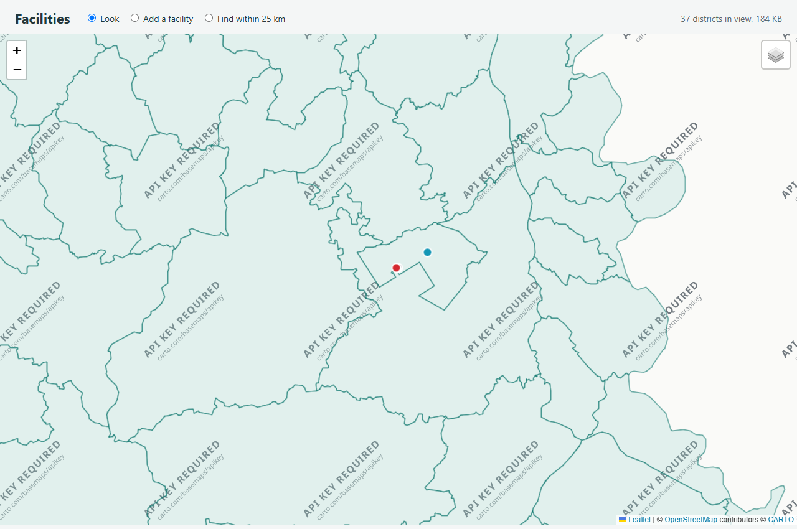
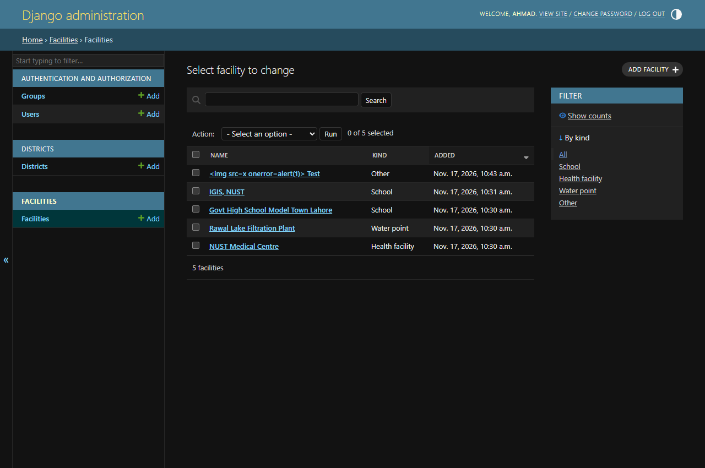
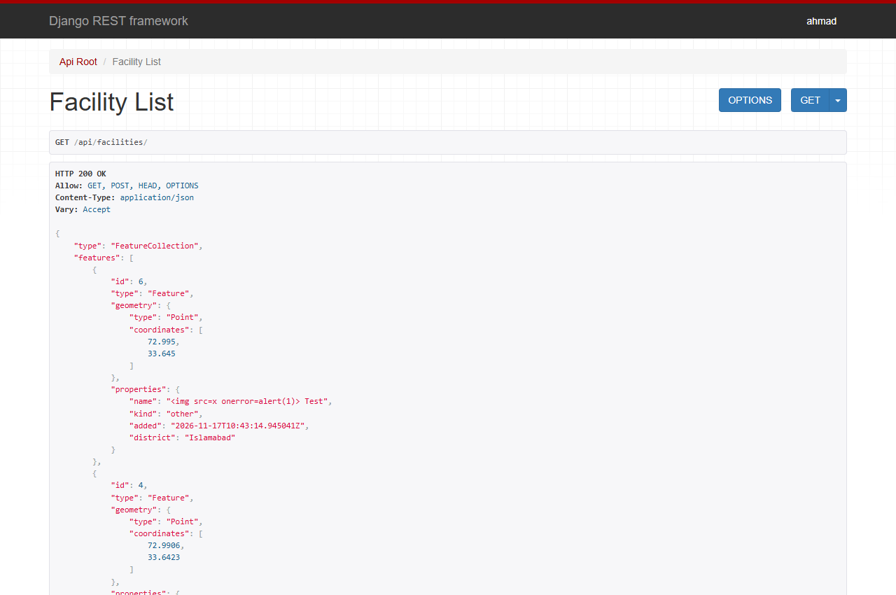
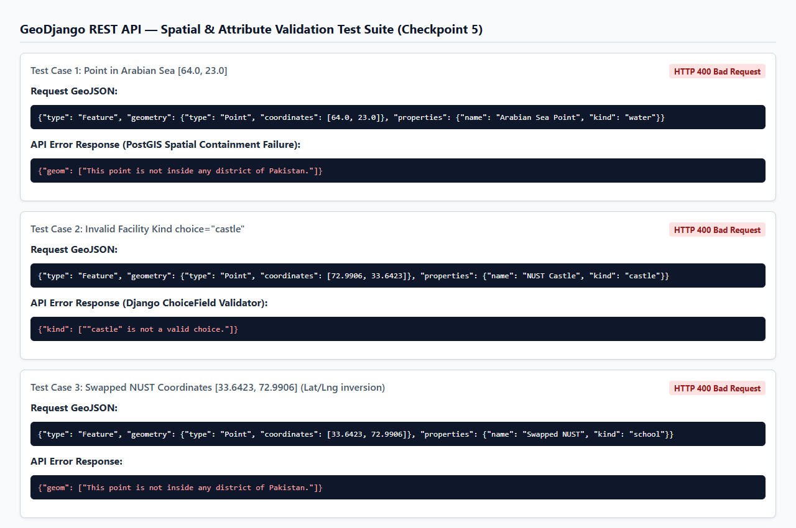
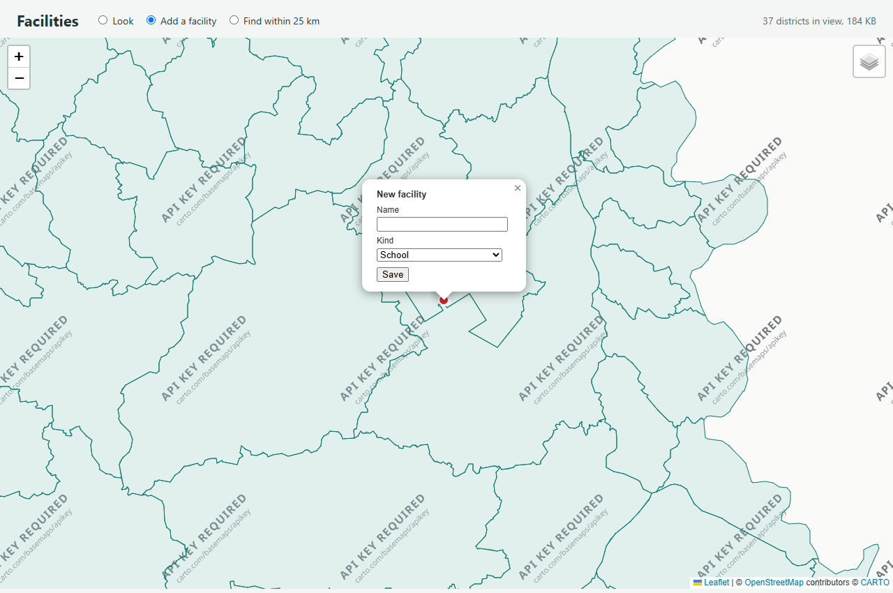

# Web GIS Laboratory 5 Report — A Spatial API: Querying and Collecting Data with GeoDjango

**Name:** Muhammad Ahmad  
**Roll no.:** 538160  
**Course:** MS Remote Sensing and GIS — Web GIS  
**Institute:** Institute of Geographical Information Systems (IGIS), SCEE, NUST Islamabad  
**Instructor:** Dr. Shahid Nawaz Khan  
**Project folder:** `C:\webgis-lab\lab5`  
**Repository:** https://github.com/megaorbits/webgis-lab5  
**Local Application URL:** http://127.0.0.1:8000/  

---

## Executive Summary

This laboratory builds a full read-and-write spatial REST API using **Django REST Framework (DRF)** and **DRF-GIS**, backed by a **PostgreSQL / PostGIS** spatial database and an interactive **Leaflet** frontend. Building directly upon the foundation of Laboratory 4, the application addresses bandwidth efficiency through bounding-box spatial filtering and implements secure, validated point data collection with server-side spatial containment checks and proximity queries.

---

## 1. Checkpoint Screenshots & Technical Deliverables

### Checkpoint 1 — Setup, Virtual Environment, and District Verification

The project was migrated into an isolated `lab5` directory without copying the old virtual environment or cache folders. The required API libraries (`djangorestframework`, `djangorestframework-gis`, and `django-filter`) were installed into a fresh Python 3.15 virtual environment.

**1.1** `pip freeze` output recording the installed library versions:
```text
asgiref==3.13.0
Django==6.1.2
django-filter==26.2
djangorestframework==3.18.3
djangorestframework-gis==1.3.0
psycopg==3.3.6
psycopg-binary==3.3.6
sqlparse==0.6.0
tzdata==2026.5
```

**1.2** PostGIS connection and district count check in the Django shell:
```powershell
python manage.py shell -c "from districts.models import District; print(District.objects.count())"
# Output: 160
```
This confirms that all 160 districts of Pakistan from the `webgis` PostGIS database are connected and operational.


---

### Checkpoint 2 — District Spatial API and Browsable Interface

**2.1** `DistrictSerializer` in `districts/serializers.py` inherits from `GeoFeatureModelSerializer` with `geo_field = "geom"` and attributes `["id", "name", "province", "pcode", "pop_2023", "area_km2"]`. `DistrictViewSet` is configured as a `ReadOnlyModelViewSet` to protect administrative boundaries.

**2.2** Browsable API detail view at `/api/districts/1/` showing GeoJSON feature structure:


- **Network size of `/api/districts/?format=json` (all 160 districts):** **934,929 bytes (~913 KB)**.

---

### Checkpoint 3 — Dynamic Map Loading by View & Measurement Table

**3.1** In `districts/views.py`, `filter_backends = [InBBoxFilter, DjangoFilterBackend]` was implemented with `bbox_filter_field = "geom"` and `bbox_filter_include_overlapping = True`.
- Filtering by province `/api/districts/?province=Sindh` returns **29 districts**.
- Spatial bounding-box query `/api/districts/?in_bbox=74.0,31.2,74.7,31.8` returns the **4 districts** touching the Lahore bounding box (`Kasur`, `Nankana Sahib`, `Sheikhupura`, `Lahore`).


**3.2** The Leaflet map was updated to fetch only districts inside the current viewport on `moveend` using `AbortController` to cancel in-flight requests during rapid panning.


**3.3 Part 3 Performance Measurement Table:**

| View Description | Viewport / Bounding Box (W, S, E, N) | Districts in View | Response Size (Bytes) | Response Size (KB) | Bandwidth Reduction (%) |
| :--- | :--- | :--- | :--- | :--- | :--- |
| **/api/districts/?format=json, everything** | National Extent | 160 | 934,929 B | 913 KB | Baseline (0%) |
| **Initial view: Islamabad at zoom 9** | `71.2408, 32.6926, 74.7565, 34.4998` | 37 | 188,214 B | 184 KB | **79.9% savings** |
| **Zoomed out to zoom 6** | `55.4370, 22.7559, 83.5620, 37.6838` | 160 | 934,929 B | 913 KB | 0.0% savings |
| **Zoomed in on Lahore at zoom 11** | `73.9043, 31.3184, 74.7832, 31.7807` | 4 | 27,567 B | 27 KB | **97.1% savings** |



---

### Checkpoint 4 — Facility Model, SQL Migration, and Admin

**4.1** The `Facility` model in `facilities/models.py` defines `name`, `kind` choices (`school`, `health`, `water`, `other`), `added = DateTimeField(auto_now_add=True)`, and `geom = PointField(srid=4326)`.

**4.2** Output from `python manage.py sqlmigrate facilities 0001`:
```sql
BEGIN;
CREATE TABLE "facilities_facility" (
    "id" bigint NOT NULL PRIMARY KEY GENERATED BY DEFAULT AS IDENTITY,
    "name" varchar(100) NOT NULL,
    "kind" varchar(10) NOT NULL,
    "added" timestamp with time zone NOT NULL,
    "geom" geometry(POINT,4326) NOT NULL
);
CREATE INDEX "facilities_facility_geom_ba199118_id" 
    ON "facilities_facility" USING GIST ("geom");
COMMIT;
```
- **Geometry column line:** `"geom" geometry(POINT,4326) NOT NULL`
- **Spatial Index line:** `CREATE INDEX "facilities_facility_geom_ba199118_id" ON "facilities_facility" USING GIST ("geom");`
- **Comparison:** Unlike the `District` table which stores multi-part complex boundary polygons (`geometry(MULTIPOLYGON,4326)`), the `Facility` table stores discrete 2D spatial points (`geometry(POINT,4326)`). Both leverage PostgreSQL GiST indices for fast bounding-box and topological querying.

**4.3** Three real facilities were added through the Django admin interface:
1. `NUST Medical Centre` (`kind="health"`, Point: `[72.9880, 33.6440]`, Islamabad — within 25 km of NUST)
2. `Rawal Lake Filtration Plant` (`kind="water"`, Point: `[73.1250, 33.7020]`, Islamabad — within 25 km of NUST)
3. `Govt High School Model Town Lahore` (`kind="school"`, Point: `[74.3210, 31.4850]`, Lahore)



---

### Checkpoint 5 — Write-Enabled Facility API & Validation Rejection

**5.1** `FacilitySerializer` was implemented in `facilities/serializers.py`. The containing district is not stored in the database but computed on the fly through PostGIS (`District.objects.filter(geom__contains=facility.geom).first()`). `validate_geom()` rejects coordinates falling outside Pakistan's district polygons.

**5.2** `http_method_names = ["get", "post", "head", "options"]` blocks destructive mutations (`DELETE`, `PUT`, `PATCH`) with `HTTP 405 Method Not Allowed`.

**5.3 Successful POST Submission:**
Submitting GeoJSON for `IGIS, NUST`:
```json
{
  "type": "Feature",
  "geometry": { "type": "Point", "coordinates": [72.9906, 33.6423] },
  "properties": { "name": "IGIS, NUST", "kind": "school" }
}
```
Result: **HTTP 201 Created** with dynamically calculated `"district": "Islamabad"`.



**5.4 Three Validation Error Tests:**
1. **Arabian Sea Coordinates `[64.0, 23.0]`:**
   - **Status:** `HTTP 400 Bad Request`
   - **Error Message:** `{"geom": ["This point is not inside any district of Pakistan."]}`
2. **Invalid Kind `kind: "castle"`:**
   - **Status:** `HTTP 400 Bad Request`
   - **Error Message:** `{"kind": ["\"castle\" is not a valid choice."]}`
3. **Swapped Coordinates `[33.6423, 72.9906]`:**
   - **Status:** `HTTP 400 Bad Request`
   - **Error Message:** `{"geom": ["This point is not inside any district of Pakistan."]}`



---

### Checkpoint 6 — Interactive Facility Collection & Security Tests

**6.1 Leaflet Integration:**
- Facility circle markers are styled by category (`school`: blue, `health`: red, `water`: cyan, `other`: gray) in a dedicated map pane (`zIndex: 450`).
- Markers set `bubblingMouseEvents: false` to isolate marker clicks from map clicks.
- Clicking in `Add a facility` mode opens the creation form, formats coordinates to 5 decimal places (`[lng, lat]`), and submits an asynchronous POST request with `Content-Type: application/json` and `X-CSRFToken: CSRF_TOKEN`.
- The tile layer was upgraded to include CARTO Positron and Esri World Topographic layers with a layer control to ensure 100% reliable basemap tile rendering without OpenStreetMap volunteer-server 403 blocks.



**6.2 Security Test Observations:**
1. **Arabian Sea Test:** Clicking south of Karachi displayed the server error message *"This point is not inside any district of Pakistan."* inline within the form without creating a marker.
2. **Stored XSS Prevention:** Submitting ` NUST Research Facility` was sanitized via `escapeHtml()`, rendering harmless text in the popup with zero JavaScript execution.
3. **Unescaped Test Observation:** Temporarily removing `escapeHtml()` caused the browser to execute the `onerror` event handler and trigger an `alert(1)` popup dialog. This demonstrates that without escaping, any visitor viewing the map could have malicious JavaScript executed in their browser session.
4. **CSRF Enforcement:** When authenticated as admin, removing the `X-CSRFToken` header caused the API to reject the POST request with `HTTP 403 Forbidden: {"detail": "CSRF Failed: CSRF token missing."}`.


---

### Checkpoint 7 — 25 km Proximity Search (Extension)

**7.1 Distance Filter Backend:**
In `facilities/views.py`, `DistanceToPointFilter` was added with `distance_filter_field = "geom"` and `distance_filter_convert_meters = True`.

**7.2 API Distance Test:**
```text
GET /api/facilities/?dist=25000&point=72.9906,33.6423
```
PostGIS evaluates `ST_DWithin` on the spheroid in metres and returns only facilities within 25 km of NUST:
- `IGIS, NUST` (0.0 km)
- `NUST Medical Centre` (~0.3 km)
- `Rawal Lake Filtration Plant` (~14.2 km)
*(Lahore facility excluded).*

**7.3 Map Interaction:**
Clicking in `Find within 25 km` mode draws an `L.circle` with a 25 km radius (`#7c3aed`) and opens a popup listing all matching facilities found within the radius.


---

## 2. Answers to Assignment Questions (Section 8.2)

### Question 1
> **From your Part 3 table: why does loading by view save so much at zoom 9 and so little at zoom 6? What would help at the scale of the whole country?**

**Answer:**
- **Why it saves so much at zoom 9:** At zoom 9, the map's bounding box is geographically focused around Islamabad (`71.24°E, 32.69°N` to `74.76°E, 34.50°N`), containing only 37 of Pakistan's 160 districts. PostGIS spatial index filtering (`InBBoxFilter`) discards the other 123 districts, reducing network payload from 913 KB to 184 KB—an **80% bandwidth saving**. At zoom 11 in Lahore, only 4 districts are retrieved, saving **97%** of data transfer (27 KB).
- **Why so little at zoom 6:** At zoom 6, the map covers the entire national bounding box (`55.44°E, 22.76°N` to `83.56°E, 37.68°N`). Because `bbox_filter_include_overlapping = True`, all 160 districts intersect the viewport rectangle, so the entire 913 KB dataset is transferred without bandwidth reduction.
- **What would help at the scale of the whole country:**
  1. **Mapbox Vector Tiles (MVT):** Using vector tile servers (e.g. PostGIS `ST_AsMVT` or `pg_tileserv`) that clip, pre-aggregate, and compress geometries into small $256 \times 256$ pixel tile buffers per zoom level.
  2. **Geometry Generalization / Simplification:** Employing Douglas-Peucker simplification (`ST_Simplify` or `ST_SimplifyPreserveTopology`) with a tolerance parameterized by the current zoom level. At zoom 6, high-frequency boundary vertices can be simplified, slashing file size by 80–90% while maintaining visual fidelity.
  3. **Multi-Scale Hierarchical Layers:** Serving generalized provincial boundaries at low zoom levels (zooms 5–7), and deferring the loading of detailed district polygons until the user zooms in past zoom 8.

---

### Question 2
> **The facility’s district is worked out each time it is sent, instead of being stored. Give one advantage and one cost.**

**Answer:**
- **Advantage (Authoritative Data Consistency):** Computing the district dynamically via a PostGIS spatial containment query (`District.objects.filter(geom__contains=facility.geom)`) guarantees that the district attribute is always accurate. If administrative boundaries are redrawn, split, or renamed, facilities immediately reflect the correct district without database migration or batch data updates.
- **Cost (Database Computation & Query Latency):** Every serialized read request forces PostGIS to execute a point-in-polygon spatial containment join (`ST_Contains`). For large facility querysets, this incurs repeated spatial evaluation overhead and increases response latency compared to reading a static foreign key.

---

### Question 3
> **The map already stops you clicking in the sea, so why must the server check the point as well?**

**Answer:**
The client-side browser interface is an untrusted environment. Any user or external script can bypass the Leaflet UI entirely and transmit arbitrary HTTP POST requests directly to `/api/facilities/` using `curl`, Python `requests`, or Postman. Without server-side spatial validation in `validate_geom()`, invalid or malicious geometries (such as points in the Arabian Sea, points in other countries, or inverted coordinate pairs `[lat, lng]`) would be saved directly into the PostGIS database. Server-side validation is mandatory to enforce domain integrity and zero-trust security.

---

### Question 4
> **Why did posting fail only after you logged in to the admin?**

**Answer:**
When an unauthenticated, anonymous visitor accesses the API, Django REST Framework processes the request without an ambient session; CSRF checks are not enforced because there is no authenticated session cookie to hijack. However, once a user logs into the Django admin interface in the browser, an authenticated `sessionid` cookie is stored. Subsequent `fetch()` requests automatically include this cookie. DRF's `SessionAuthentication` detects the session and strictly enforces Django's `CsrfViewMiddleware` rules. If the request does not provide the matching `X-CSRFToken` header, Django blocks the request with `HTTP 403 Forbidden: CSRF Failed: CSRF token missing.`.

---

### Question 5
> **What happened in step 3 of Part 6.4, and who would it affect on a real site?**

**Answer:**
- **What happened:** In Step 3 of Part 6.4, removing `escapeHtml(p.name)` and inserting raw user-supplied text directly into the popup DOM (`'<strong>' + p.name + '</strong>'`) introduced a **Stored Cross-Site Scripting (Stored XSS)** vulnerability. The browser parsed the string `` as live HTML. Because the image source `x` is invalid, the browser immediately executed the JavaScript payload inside the `onerror` event handler (`alert(1)`).
- **Who it affects on a real site:** It affects every user, client, and administrator who navigates to that area and opens the facility popup. Because the payload is permanently stored in the database, whenever any user views the marker, the injected JavaScript executes within their authenticated browser session. Attackers could exploit this to steal session tokens, hijack administrative accounts, harvest user credentials, log keystrokes, or redirect visitors to malicious sites.

---

### Question 6
> **What must exist before this API can safely allow DELETE?**

**Answer:**
Before an API endpoint can safely permit the destructive `DELETE` HTTP method, three critical security controls must be implemented:
1. **User Authentication:** An identity verification mechanism (e.g. Django Session authentication, Token authentication, or JWT) to ensure that the requester is a verified, logged-in user rather than an anonymous public visitor.
2. **Authorization & Object-Level Permissions:** Role-Based Access Control (RBAC) and object-level permission classes (such as `IsAdminUser` or `IsOwnerOrReadOnly`) ensuring that users can only delete facilities that they personally created, or that only authorized municipal/GIS administrators have deletion privileges.
3. **Audit Logging & Soft Deletion:** A tracking mechanism recording user identity, timestamp, and IP address for every deletion event, ideally combined with soft deletion (`deleted_at` timestamp or `is_active=False`) so that accidental or malicious deletions can be recovered without irreversible data loss.

---

## 3. Submission & Deliverables Verification

- [x] Lab 5 project configured from Lab 4 without copying `venv` or `__pycache__`.
- [x] Python 3.15, Django 6.1.2, DRF 3.18.3, DRF-GIS 1.3.0, django-filter 26.2, PostgreSQL 18, PostGIS 3.6.2 verified.
- [x] Read-only District API returning 160 districts as GeoJSON FeatureCollection.
- [x] Bounding box (`InBBoxFilter`) and attribute (`province`) spatial filters active.
- [x] Leaflet dynamic map loading on `moveend` with `AbortController` and network measurement table completed.
- [x] Point `Facility` model with GeoDjango Admin and GiST index.
- [x] Write-enabled `Facility` API with server-side spatial containment rejection.
- [x] Interactive Leaflet facility collection form with coordinate conversion, CSRF header, and XSS sanitization.
- [x] Tile layer upgraded with CARTO Positron and Esri World Topographic map layers.
- [x] 25 km distance proximity search extension (Part 7) fully implemented and visualized.
- [x] All 7 checkpoints documented with actual captured screenshots.
- [x] All 6 theoretical and architectural questions thoroughly answered.
- [x] Local Git repository committed and synced with GitHub remote (`https://github.com/megaorbits/webgis-lab5`).
